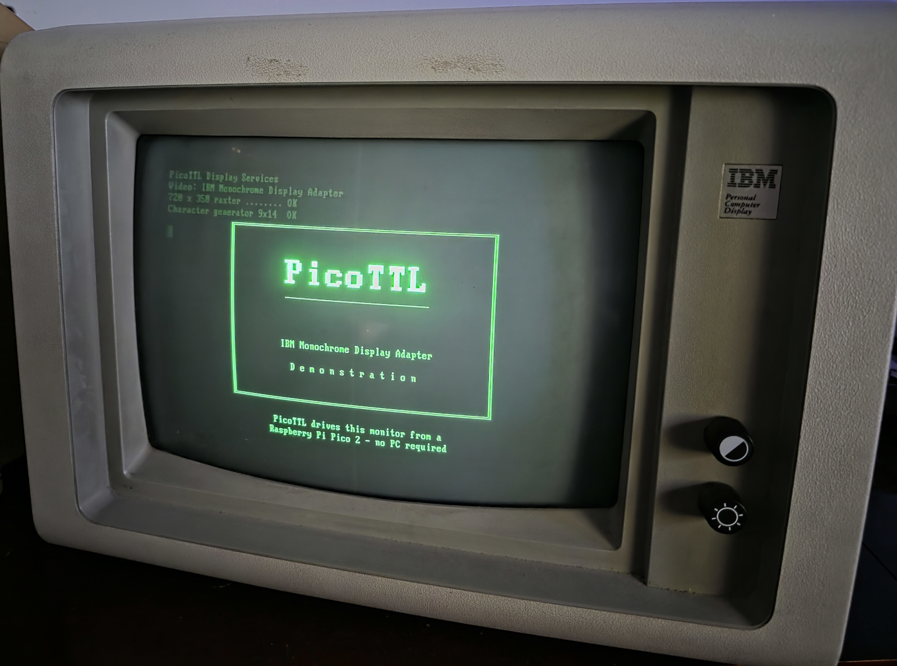
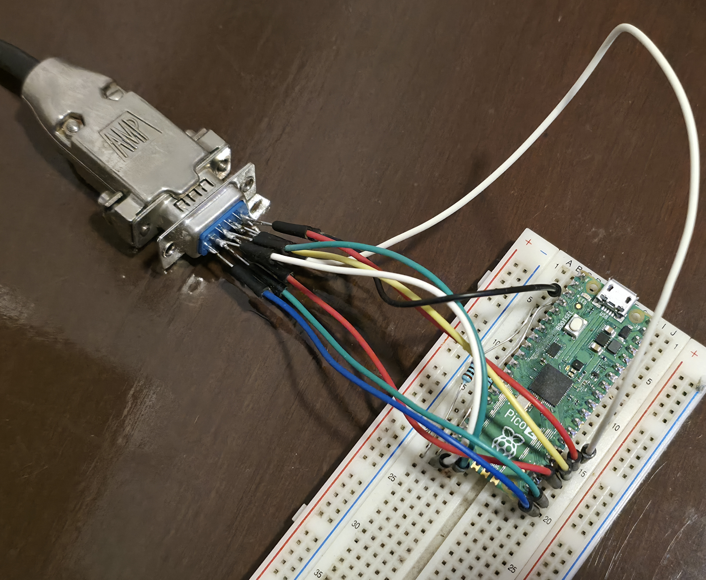
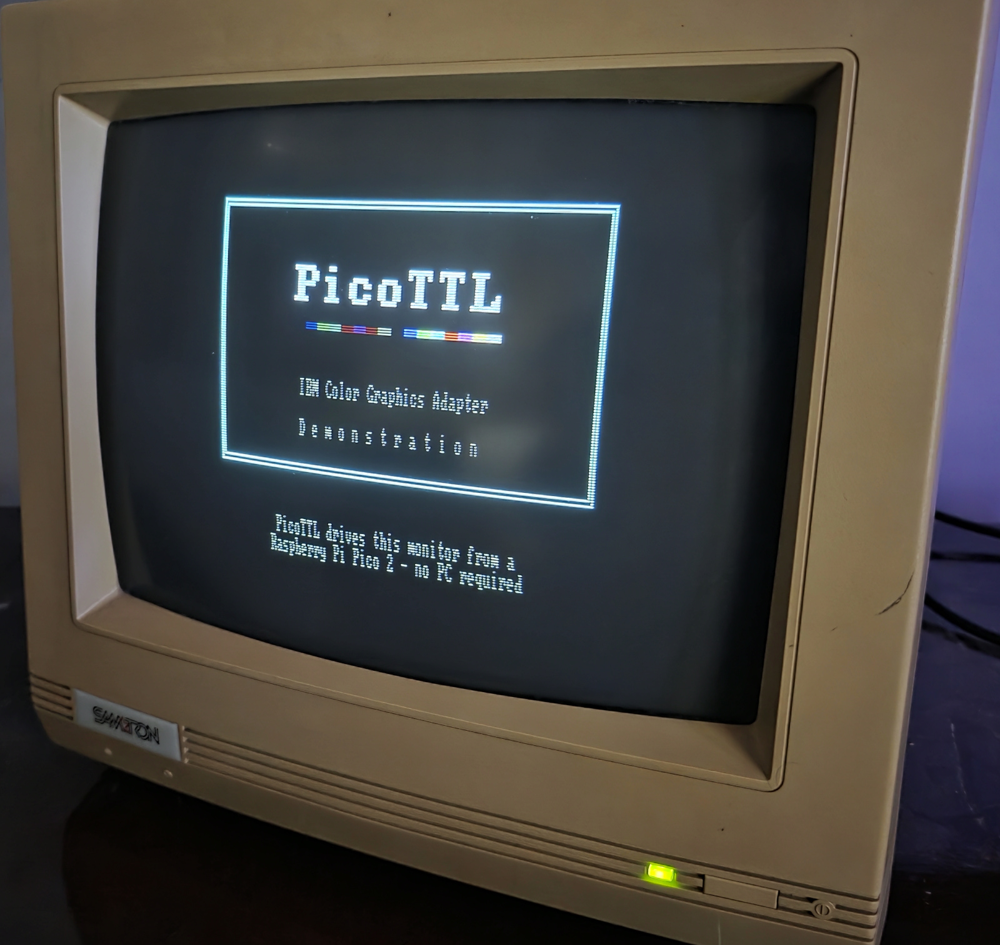
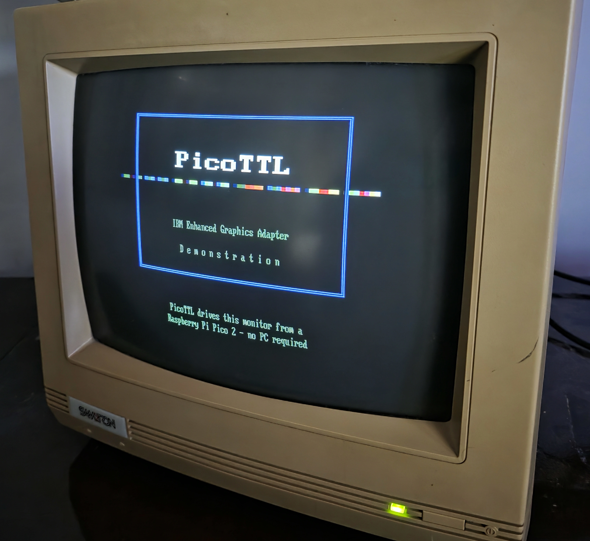

# PicoTTL

[](https://github.com/jesus966/PicoTTL/actions/workflows/ci.yml)
[](https://github.com/jesus966/PicoTTL/releases)
[](LICENSE)
[](https://github.com/jesus966/PicoTTL/releases/latest)

TTL video framework for the Raspberry Pi Pico 2 (RP2350). PicoTTL uses
PIO and DMA for IBM MDA, CGA and EGA scanout, with **no CPU service on the
signal path** after startup. Applications draw into caller-owned memory.
Start with [Getting started](docs/getting-started.md) to choose a backend,
build an example and understand the electrical checks before connecting a monitor.



```
Application code                     Signals on the DE-9
----------------------------------  -------------------------------
Display display(device);            HSYNC / VSYNC, TTL levels
display.begin(VideoMode::IbmMda);   720x350 @ 50 Hz (18.43 kHz)
text.print("Hello, 1981");          pixel-exact 9x14 IBM glyphs
```

## AI-driven implementation, human-directed engineering

Nearly all PicoTTL code and documentation are written using AI tools.
The human maintainer directs the engineering, approves architectural and
technical decisions, and is responsible for verification and acceptance.
AI-generated changes undergo engineering review and verification.
The maintainer reports physical tests of all examples on Pico 2 using Arm
Cortex-M33, with an IBM 5151 and a Samtron SC-431E. These reports are
distinct from host tests, builds and electrical measurements. See the
[AI Development Policy](AI_POLICY.md).

## Goals

- Drive **original IBM monitors** (MDA 5151, CGA 5153-class, EGA 5154)
  with historically exact timings, character sets and colors.
- A **stable, frozen public API**: application code written today keeps
  compiling against every future version (see
  [docs/api_evolution.md](docs/api_evolution.md)).
- **Zero CPU on the signal path**: after `begin()`, scanout is entirely
  PIO + DMA; the CPU only draws into the framebuffer.
- Platform independence above the backend boundary: the same
  `Graphics`/`Text`/`Terminal` code runs on MDA, CGA, EGA and a host
  (desktop) backend used for automated regression testing.

## Supported standards

| Standard | Modes | Format | Status |
|---|---|---|---|
| IBM MDA | 720×350 @ 50 Hz | Mono1 / Packed2 (video + intensity) | Maintainer-reported tests on IBM 5151 |
| IBM CGA | 640×200, 320×200 @ 60 Hz | Mono1 / Packed2 / Packed4 (RGBI) | Maintainer-reported tests on Samtron SC-431E |
| IBM EGA | 640×350 @ 60 Hz (+ CGA-compatible 200-line modes) | up to Packed8 (6-wire rgbRGB, 64 colors) | Maintainer-reported tests on Samtron SC-431E |
| Host | all of the above | all formats | In-memory backend for the automated test suite |

Supported hardware: **Raspberry Pi Pico 2 (RP2350)**, Pico SDK 2.3.0,
C++17, no external libraries. The architecture is explicitly designed
for future backends (other platforms, other display families) - see
[docs/architecture.md](docs/architecture.md), section 10.

## Design philosophy

The project is governed by written principles
([docs/design_principles.md](docs/design_principles.md)); the ones you
will notice first:

- **Public API stability has priority over implementation
  convenience.** The API grows additively; existing signatures never
  change. Every example must compile unmodified after every change.
- **Design first.** Architecture is reviewed and documented before
  code is written.
- **Historical authenticity.** Timings come from IBM's 6845 tables;
  fonts are generated from IBM character ROM dumps; CGA color 6 is
  brown for the same reason it was in 1981.
- **Hardware validation.** Every feature ships with an example that
  supports real-CRT testing. Validation results identify the tested hardware
  and scope; later signal-path changes need appropriate regression evidence.
- **No hidden machinery**: no heap allocations, no exceptions, no
  interrupts taken by the framework, no implicit hardware claims. The
  application owns every buffer and every hardware resource listed in
  a backend `Config`.

## Architecture summary

```
Application
  Terminal / AnsiTerminal      cell buffer, cursor, blink, ANSI parsing
  Text                         byte -> glyph rendering, code pages
  Graphics                     lines, rects, bitmaps, clipping
  DisplaySurface / Framebuffer pixel access, packed formats (1/2/4/6/8 bpp)
  Display + DisplayDevice      the portability boundary
    rp2350::MdaDisplayDevice   |
    rp2350::CgaDisplayDevice   |  PIO + DMA scanline engines
    rp2350::EgaDisplayDevice   |
    host::HostDisplayDevice    in-memory scanout for tests
```

Everything above `DisplayDevice` is platform-independent and identical
across backends. The full reference is
[docs/architecture.md](docs/architecture.md).

## Current status

The maintainer reports testing all examples on a Raspberry Pi Pico 2
using Arm Cortex-M33, with an IBM 5151 and a Samtron SC-431E CGA/EGA
monitor. Host tests, SDK recordings, static analysis and firmware builds provide separate
software-verification evidence. These results do not imply electrical
measurements that have not been recorded, or validation of every later change.

- Three IBM standards implemented and tested on real monitors.
- 45 numbered examples (each validates exactly one feature), 3
  showcase demonstrations, 3 CRT diagnostics applications.
- Automated host regression tests (no hardware required); see
  [the quality workflow](docs/code_quality.md) for scope and limitations.
- IBM code pages 437 (default) and 850, generated from authentic ROM
  and CPI font data.
- One canonical wiring (the EGA-superset **reference connector**) for
  all monitors.

## Quick start

Prerequisites: [Pico SDK](https://github.com/raspberrypi/pico-sdk)
2.3.0 (the VS Code Raspberry Pi Pico extension installs everything),
CMake ≥ 3.13, Ninja, ARM GCC. The commands below use the default Arm
configuration, also used for the physical tests reported above.

```sh
git clone https://github.com/jesus966/PicoTTL.git
cd PicoTTL
# PICO_SDK_PATH must point at a Pico SDK 2.3.0 checkout (the VS Code
# Pico extension configures this automatically).
cmake -S . -B build -G Ninja
cmake --build build
```

Every example produces a UF2 under `build/examples/` when built locally.
Precompiled UF2 packages for the latest release are available from the
[GitHub Releases](https://github.com/jesus966/PicoTTL/releases) page.

To flash a locally built example, hold BOOTSEL, plug in the Pico 2, and copy e.g.
`build/examples/17_hello_world/picottl_example_17_hello_world.uf2`
onto the mass-storage device.

Run the automated test suite on your PC (no Pico needed):

```sh
cmake -S tests -B build-host -G Ninja
cmake --build build-host
ctest --test-dir build-host --output-on-failure --verbose --no-tests=error
```

## Using PicoTTL in your project

After initializing the Pico SDK in your application's CMake project, add
PicoTTL as a subdirectory and link its public target:

```cmake
add_subdirectory(external/PicoTTL)
target_link_libraries(my_app PRIVATE picottl)
```

This adds the library without building PicoTTL's examples or diagnostics.
See [docs/integration.md](docs/integration.md) for a complete minimal project
and submodule, vendored-copy and FetchContent integration.

## Wiring

The table below records the example reference-connector mapping. It is not
a universal connection procedure: verify connector orientation, monitor
scan-rate limits, grounding, voltage margins and loading before connecting.
Dedicated CGA backend examples have an intensity-pin exception described in
[the full reference](docs/architecture.md#15-the-reference-connector).

| GPIO | DE-9 pin | MDA | CGA | EGA |
|------|----------|-----|-----|-----|
| 2  | 8 | HSYNC | HSYNC | HSYNC |
| 3  | 9 | VSYNC | VSYNC | VSYNC |
| 16 | 5 | - | Blue | Primary Blue |
| 17 | 4 | - | Green | Primary Green |
| 18 | 3 | - | Red | Primary Red |
| 19 | 7 | VIDEO | (reserved) | Secondary Blue |
| 20 | 6 | INTENSITY | Intensity | Secondary Green |
| 21 | 2 | - | - | Secondary Red |
| GND | 1 | GND | GND | GND |

Example headers specify 470-ohm series resistors on HSYNC and VSYNC and
GPIO 4 as an internal handshake, left unwired. DE-9 pin 2 is an EGA signal,
not a common ground connection. Preserve the distinction between these
code/example assignments and a verified electrical interface for your monitor.

### Electrical checks

Source code and host tests establish neither voltage margins nor permissible
input loading. The reported monitor tests are not a universal approval of
direct 3.3 V GPIO connections or a specification for a level translator.
A monitor-specific electrical assessment is required; no new connection
circuit is defined here.

> **CRT compatibility:** verify supported scan rates before connecting or
> changing modes. Engine acceptance of a timing does not establish monitor
> compatibility or the presence of protective circuitry.



## Examples

Each example validates one feature and documents expected output,
wiring and known regressions in its header.

| Range | Backend | Topics |
|---|---|---|
| 01–15 | MDA | sync, pixel path, graphics primitives, bitmaps, stress/regression patterns |
| 16–24 | MDA | fonts, text, attributes, scrolling, Terminal, ANSI serial terminal |
| 25–33 | CGA | sync, 16 RGBI colors, 320/640 modes, graphics, text, terminals |
| 34–42 | EGA | sync, 64 colors, CGA-compatible modes, graphics, text, terminals |
| 43 | multi | host image display over USB CDC (PC -> monitor, Python host) |
| 44 | MDA | IBM code pages: CP437 vs CP850 |
| 45 | MDA | Matrix rain tuned for medium/high-persistence phosphor monitors |
| 96–98 | MDA/CGA/EGA | official showcase demonstrations |

Diagnostics: `apps/{mda,cga,ega}_crt_diagnostics/`
are pattern suites for testing and adjusting real CRTs.

### Showcase demonstrations

#### Demo 96: MDA


#### Demo 97: CGA



#### Demo 98: EGA



## Documentation map

| Reader / task | Entry point |
|---|---|
| First display or host-only trial | [Getting started](docs/getting-started.md) |
| Embed the library / build requirements | [Integration](docs/integration.md) |
| API contracts and compatibility | [Public headers](include/picottl/PicoTTL.hpp), [API evolution](docs/api_evolution.md) |
| Architecture, memory, pins and clocks | [Architecture](docs/architecture.md) |
| Clipping / DMA lifecycle details | [Graphics clipping](docs/graphics_clipping.md), [DMA stop/restart](docs/rp2350_dma_stop.md) |
| USB image transfer | [Example 43](examples/43_host_image/README.md) |
| Tests, sanitizers, analysis and coverage | [Code quality](docs/code_quality.md), [diagnostic triage](docs/code_quality_findings.md) |
| Contribute or prepare a release | [Contributing](CONTRIBUTING.md), [design principles](docs/design_principles.md) |
| AI development and agent instructions | [AI policy](AI_POLICY.md), [AGENTS.md](AGENTS.md) |
| Licensing / conduct / security | [Provenance](THIRD_PARTY_LICENSES.md), [conduct](CODE_OF_CONDUCT.md), [security](SECURITY.md) |
| Release history / documentation review | [Changelog](CHANGELOG.md), [documentation audit](docs/documentation-audit.md) |
| Feature examples | Numbered `examples/*/main.cpp` headers describe expected output and regressions |

## Roadmap

- Overscan and non-IBM raster variants (the engine already accepts
  representable custom timings internally; public `begin()` accepts catalog
  `VideoMode` values, not an arbitrary timing descriptor).
- Additional display families (e.g. Amstrad monitors) as new backends.
  (Hercules is deliberately NOT on this list: PicoTTL's MDA backend is
  already pixel-addressable at 720×350 on the same monitor, a strict
  superset of Hercules graphics; exact 720×348 raster timing, if ever
  wanted, would be an additive `VideoMode` on the MDA backend.)
- Additional code pages (CP852, CP858) - structurally additive.

## Contributing

See [CONTRIBUTING.md](CONTRIBUTING.md). In short: design review before
code, documentation with the change, additive API evolution only, and
hardware validation on a real monitor for anything that touches the
signal path.

## License

MIT - see [LICENSE](LICENSE).

Font data provenance: the CP437 glyph data is generated from IBM
character ROM dumps (via
[spacerace/romfont](https://github.com/spacerace/romfont)); the CP850
glyph data comes from IBM PC-DOS 2000 codepage files (via
[viler-int10h/vga-text-mode-fonts](https://github.com/viler-int10h/vga-text-mode-fonts)).
The provenance of this historical compatibility data, and the
good-faith basis on which the project includes it, are documented in
[THIRD_PARTY_LICENSES.md](THIRD_PARTY_LICENSES.md); the generator
scripts live in `tools/`.
