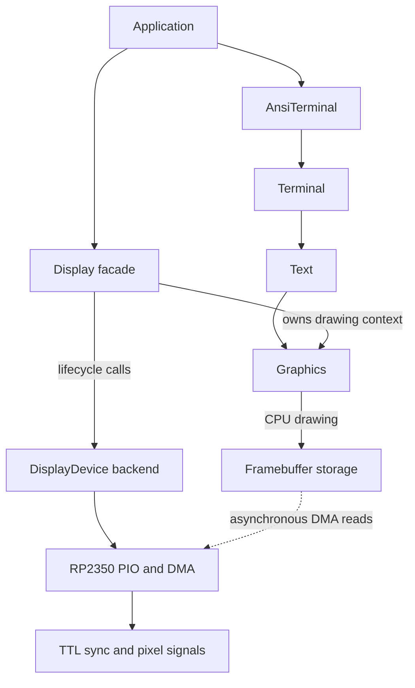

# Getting started with PicoTTL

PicoTTL lets an RP2350 application draw pixels and text while PIO state
machines and DMA generate IBM MDA, CGA or EGA TTL video. It is not VGA,
HDMI, a USB display adapter or a full PC video-card emulator. The host
backend renders into memory and generates no electrical signal.

## Choose a display family first

| Device | Catalog modes | RP2350 framebuffer formats | Text example |
|---|---|---|---|
| MdaDisplayDevice | IbmMda 720x350; MdaOverscan 736x352 | Mono1, Packed2 | [17: Hello World](../examples/17_hello_world/main.cpp) |
| CgaDisplayDevice | IbmCga640 640x200; IbmCga320 320x200 | Mono1, Packed2, Packed4 | [31: CGA text](../examples/31_cga_text/main.cpp) |
| EgaDisplayDevice | IbmEga350 640x350; both CGA modes | Mono1, Packed2, Packed4, Packed8 | [40: EGA text](../examples/40_ega_text/main.cpp) |

These names identify rasters and backend capabilities, not a promise that
any connected monitor accepts them. Packed6 is a portable CPU framebuffer
format; the current RP2350 pixel streamer cannot consume it. Six-wire EGA
uses Packed8, driving the low six bits.

**Before connecting a monitor:** establish its supported scan rates,
connector orientation, grounding, electrical compatibility and the chosen
example's pin assignments. The [reference connector](architecture.md#15-the-reference-connector)
is an example wiring convention, not universal electrical approval.
Dedicated CGA examples use a different intensity-pin assignment from the
EGA-based reference-connector applications. For the examples using HSYNC on GPIO 2, leave GPIO 4 unwired:
the pixel path uses it internally for display-enable. This guide does not
supply a new direct-connection or level-converter circuit.

## How the pieces fit



The drawing layers are optional: an application can use Graphics directly,
add Text, add Terminal for cell state/scrolling/blink, or add AnsiTerminal to
interpret incoming bytes. A device without a framebuffer can generate
sync-only output. Nothing in the diagram transfers ownership of caller buffers.

## Build one existing example

Use Raspberry Pi Pico 2, Pico SDK 2.3.0 with its required submodules, a
compatible Arm toolchain, CMake and Ninja. These commands assume a checked-out
repository and a configured `PICO_SDK_PATH`. The SDK defaults for `pico2`
select Arm; do not infer RISC-V testing from an Arm build. See
[integration requirements](integration.md#requirements) for embedding the library.
Use a recent CMake/CTest supporting `--test-dir` and `--no-tests=error` for
the host commands below; they are verified locally with CMake 3.28.3.

From the repository root, build the MDA text example without a monitor attached:

```sh
cmake -S . -B build -G Ninja -DPICO_BOARD=pico2
cmake --build build --target picottl_example_17_hello_world
```

The output is
`build/examples/17_hello_world/picottl_example_17_hello_world.uf2`.
Hold BOOTSEL while connecting USB, then copy that UF2 to the board's
mass-storage volume. Building or copying firmware is not a signal measurement.
Only use a monitor after the checks above, with firmware for that display family.
For CGA or EGA, read the linked example and its `CMakeLists.txt` first rather
than flashing the MDA example to another monitor. `cmake --build build` builds
all examples, demonstrations and diagnostics.

Example 17 contains the complete application: aligned caller-owned pixel
storage, a framebuffer wrapper, backend Config, an application-lifetime device,
a Display, and Text over `display.graphics()`. It draws before `begin()` and
then starts output. For your own code, query Display geometry after a
successful `begin()` as guaranteed by its header; drawing uses the bound
surface geometry and may precede startup. Retain the example's clock setup, check `begin()` results
in your own applications, and keep that clock stable while output runs.
Do not put the backend's large timing table on an inadequately sized stack.

## No board or monitor? Run the host suite

The native project needs neither Pico SDK nor an Arm compiler:

```sh
cmake -S tests -B build-host -G Ninja
cmake --build build-host
ctest --test-dir build-host -N
ctest --test-dir build-host --output-on-failure --verbose --no-tests=error
```

One CTest registration runs the full case-reporting executable. These tests
exercise rendering, contracts and recorded SDK operations; they do not
execute physical PIO instructions or DMA bus transfers. See
[code quality](code_quality.md) for sanitizers, coverage and static analysis.

## Common lifecycle and storage rules

- Pixel memory is borrowed. Use `PackedFramebuffer<N>::bytesFor(W, H)` and
  pass the actual capacity to its constructor. RP2350 scanout additionally
  requires four-byte address/size alignment and a matching mode and format.
- `begin(mode)` can fail. An already active device accepts only the same
  mode; call `end()` before changing modes or framebuffers.
- `end()` stops output but preserves the drawing binding. An accepted
  `Display::setFramebuffer()` immediately rebinds Graphics; nullptr makes
  drawing inert. Acceptance does not prove compatibility: the next `begin()`
  validates the mode/framebuffer combination. Rejected changes preserve binding.
- Pause other CPU users, stop output and detach/replace the framebuffer
  before freeing it. Serialize lifecycle operations and overlapping CPU
  storage accesses. Live CPU drawing during DMA scanout may tear.
- Text renders byte-indexed glyphs, not UTF-8. FontFamily selects CP437/CP850.
  Terminal requires its own cell buffer and periodic `update(nowMs)` calls.
  Recreate Terminal if its snapshotted grid geometry changes.

The [ownership reference](architecture.md#5-object-ownership-and-lifetime)
and public headers define the full contracts.

## Evidence and next steps

The maintainer reports testing all examples on Pico 2 in Arm mode with an
IBM 5151 and Samtron SC-431E. This review has not performed hardware tests.
Those reported observations do not document voltage margins, scope traces,
RISC-V execution, every RP2350B board or validation of subsequent changes.
An accepted custom timing is not a CRT compatibility test.

| Your next task | Start here |
|---|---|
| Add PicoTTL to an existing application | [Integration](integration.md) |
| Find an API contract | [Public umbrella header](../include/picottl/PicoTTL.hpp), then the relevant included header |
| Understand clipping or extreme coordinates | [Graphics clipping](graphics_clipping.md) |
| Debug pins, timing, memory or lifecycle | [Architecture](architecture.md), [DMA stop/restart](rp2350_dma_stop.md) |
| Feed images over USB | [Example 43 protocol and sender](../examples/43_host_image/README.md) |
| Change implementation or prepare a release | [Contributing](../CONTRIBUTING.md), [API compatibility](api_evolution.md) |
